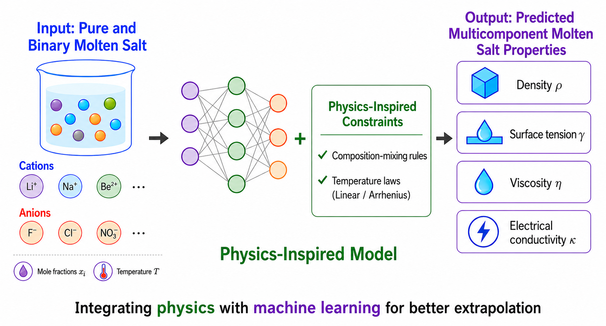

# Physics-Inspired Neural Models for Mixture-Order Extrapolation of Molten Salt Thermophysical and Transport Properties

Wenshuo Liang$^{b,\dagger}$, Yuan Yin$^{a,\dagger}$, Wentao Zhou$^{a,*}$, Dezhong Wang$^{a}$

$^{a}$ School of Nuclear Science and Engineering, Shanghai Jiao Tong University, Shanghai 200240, China

$^{b}$ Shanghai Smartlogic Technology Ltd., Shanghai 200040, China

*Corresponding author. E-mail: zhwentao@sjtu.edu.cn (Wentao Zhou)*

$^{\dagger}$ These authors contributed equally to this work.

## Abstract

Thermophysical and transport properties of molten salts are essential for advanced nuclear energy, concentrated solar thermal storage, and high-temperature electrochemical technologies, yet data for multicomponent salts remain scarce. Here we develop a physics-inspired component-encoded neural framework to learn transferable composition--temperature--property relationships from pure and binary systems. The framework uses structured salt-component representations and compares unconstrained models, composition-weighted Redlich--Kister (CW+RK) neural mixing models, and linear or Arrhenius-type temperature-constrained models under a unified mixture-order extrapolation protocol. Data are compiled from the Janz compilation and MSTDB-TP v4.0; models are trained on pure and binary systems and tested on ternary and higher-order systems. The best test-set Pearson $r$ values across density, surface tension, viscosity, and electrical conductivity range from 0.94 to 0.99 in the corresponding evaluation spaces. The most effective physics-inspired modeling choice is property dependent: density benefits most from low-order RK correction; surface tension is metric dependent, with the unconstrained model favored by RMSE and the linear model by MAE and correlation; viscosity is best captured by an Arrhenius-type temperature form; and electrical conductivity shows comparable unconstrained and Arrhenius-type performance. These results indicate that mixture-order extrapolation is improved by matching the physics-inspired model form to the target property, rather than by imposing stronger universal constraints.

**Keywords:** molten salts; physics-inspired machine learning; thermophysical and transport properties; mixture-order extrapolation

## 1. Introduction

Molten salts combine high-temperature stability, low vapor pressure, broad liquid temperature ranges, and tunable thermophysical, transport, and electrochemical properties, making them important functional media for advanced nuclear energy systems, concentrated solar thermal storage, high-temperature electrochemistry, metallurgy, and materials processing \cite{janz1988molten,roper2022molten,gonzalezroubaud2017review,luiz2024review}. In these applications, multiple salts are often mixed to tune melting point, density, viscosity, electrical conductivity, corrosion behavior, and thermal stability, so molten-salt design becomes a problem of predicting and optimizing properties in multicomponent composition spaces. Reliable salt screening, process design, and heat-transfer analysis require models that learn transferable composition–temperature–property relationships from limited data.

Substantial efforts by NIST, ORNL, and related communities have produced evaluated molten salt property compilations and databases for thermophysical modeling and engineering use. The classic Janz compilation and the NIST Properties of Molten Salts Database (formerly SRD 27) treat density, viscosity, surface tension, and electrical transport as major data categories \cite{janz1988molten,janz1992nist}. These properties control volume response, flow resistance, interfacial behavior, and electrochemical efficiency, respectively. However, high temperature, corrosion, hygroscopicity, volatility, impurity sensitivity, and container compatibility make molten salt measurements costly and difficult to reproduce, especially for systems containing beryllium, actinides, or complex multivalent metal ions \cite{roper2022molten,chesser2025mstdb,magnusson2020review}. Data coverage is also highly uneven: NIST SRD 27 contains extensive inorganic molten salt data, but multicomponent records are dominated by binary mixtures, while ternary and higher-order systems are much sparser \cite{janz1992nist}. The Molten Salt Thermal Properties Database--Thermophysical (MSTDB-TP) continues to expand evaluated data for density, viscosity, thermal conductivity, heat capacity, and surface tension, including its v4.0 release \cite{chesser2025mstdb}. Nevertheless, coverage remains uneven across properties, salt families, and mixture orders \cite{serranolopez2013molten}. Thus, the key limitation is not only sample count but also structural imbalance: low-order systems are relatively well represented, whereas higher-order mixtures are systematically scarce. This imbalance limits the stable extrapolation of empirical correlations and mixing rules to complex composition spaces.

Traditional molten salt property models rely on empirical correlations, thermodynamic or semi-empirical mixing rules, and CALPHAD-type thermochemical models. Empirical correlations often use property-specific temperature functions for pure salts or fixed mixtures, such as linear temperature relations for density and surface tension and Arrhenius-type relations for viscosity and electrical conductivity. These expressions are compact and useful for engineering calculations, but their parameters are usually specific to salts, composition ranges, and temperature intervals. CALPHAD methods and thermochemical databases provide thermodynamically consistent descriptions of phase equilibria, Gibbs energies, and reaction or mixing thermodynamics, and are important for molten salt reactor fuel salts and fission-product behavior \cite{xiong2022fundamental,besmann2024applications}. However, they primarily target phase stability and thermodynamic consistency, whereas the present work focuses on database-level rapid prediction of engineering properties. Redlich--Kister (RK) polynomials and related expansions can explicitly describe excess properties and non-ideal mixing effects \cite{redlich1948algebraic}, and have been applied to density estimation in molten fluoride pseudo-ternary salts, density estimation in chloride ternaries, and viscosity estimation in molten halide mixtures \cite{birri2022redlich,birri2024viscosity,agca2022empirical,gallagher2022assessment}. The RK form can represent binary non-ideality with low-order composition polynomials, but its interaction parameters are system specific. When binary data are sparse, or when the target system contains poorly characterized salt pairs, parameter availability and transferability become limiting. A central modeling challenge is therefore to represent chemical composition, mole fractions, temperature dependence, and non-ideal mixing within a learnable framework that transfers from low-order systems to higher-order mixtures. Because density, viscosity, surface tension, and electrical conductivity reflect different physical processes, namely bulk mixing, flow, interfacial behavior, and electrical transport, it remains unclear whether a single mixing rule or temperature law can support all of these properties.

Machine learning has recently introduced two complementary routes for molten salt structure--property modeling: atomistic potential learning and database-level composition--temperature--property prediction \cite{porter2022computational,ravichandran2024eutectics}. Atomistic approaches construct machine-learning interatomic potentials (MLIPs), including Behler--Parrinello neural network potentials, Deep Potential models \cite{behler2007generalized,zhang2018deep}, NequIP \cite{batzner2022e3}, and MACE \cite{batatia2022mace}. These methods are typically trained on DFT energies, forces, and stresses to approximate first-principles potential-energy surfaces, after which molecular dynamics can predict thermophysical and transport properties \cite{lam2021modeling}. Recent work by Shen et al. used MACE to build SuperSalt, an MLIP for chloride salt systems containing 11 cations, achieving high accuracy in multicomponent molten salt molecular dynamics and density deviations below 2% relative to AIMD and approximately 5% relative to experiment \cite{shen2025supersalt}. This route, however, still requires substantial DFT-labeled data; for example, SuperSalt used approximately $(7.0 \times 10^4)$ labeled configurations for training \cite{shen2025supersalt}. Atomistic MLIPs are therefore powerful for high-accuracy simulations and microscopic mechanistic analysis of selected systems \cite{gibson2025computing}, but they do not directly replace database-level rapid screening across large composition spaces.

The second route directly learns supervised mappings from composition and temperature to properties. This level of modeling is computationally inexpensive and better suited to screening candidate multicomponent systems, and it is the focus of the present work. Barra et al. developed a chemistry-informed transfer learning framework that combines semi-empirical RK relations with MSTDB-TP data to train neural networks for molten salt mixture density prediction \cite{barra2025generalizable}. That work demonstrates the value of chemical descriptors and semi-empirical mixing relations, whereas we focus on a different question: when low-order systems are available but higher-order mixture data are scarce, which inductive biases allow stable transfer from pure and binary systems to ternary and higher-order composition spaces? Unlike prior work focused primarily on density, we compare composition-weighted (CW) RK-style composition-mixing models with property-specific linear and Arrhenius temperature-constrained models. The former represent composition-weighted contributions and pairwise non-ideal mixing corrections, whereas the latter constrain the temperature dependence of different properties. Our goal is not to show that one physical structure universally improves prediction accuracy, but to compare where different inductive biases are useful for mixture-order extrapolation across multiple molten salt properties.

We use mixture-order extrapolation as the central evaluation protocol. Models are trained on low-order systems and tested on higher-order mixtures, matching the practical setting in which high-order molten salt data are systematically sparse. This setting differs from complete leave-component-out chemical extrapolation: test systems are not required to contain entirely unseen ions or salts. Instead, the task is to determine whether a model can recombine component contributions, binary interactions, and temperature dependencies learned from low-order data into higher-order composition spaces.

The main contributions of this work are threefold. First, we develop a component-encoded physics-inspired neural framework in which a CW+RK-style model represents composition-weighted contributions and pairwise non-ideal corrections, while linear and Arrhenius temperature-constrained models represent property-specific temperature laws. Second, we construct ion-aware structured component representations that include formula, cation, anion, and stoichiometry, enabling the model to learn transferable chemical information at the salt-component level. Third, we systematically evaluate these inductive biases for density, viscosity, surface tension, and electrical conductivity under a unified mixture-order extrapolation protocol, revealing where each bias helps or fails when transferring from low-order systems to higher-order molten salt mixtures.

## 2. Methods

### 2.1 Dataset construction

We integrated the Janz molten salt property compilation with MSTDB-TP v4.0 to construct the datasets \cite{janz1988molten,chesser2025mstdb}. Surface tension and electrical conductivity were mainly obtained from the Janz correlations, whereas density and viscosity were obtained from both Janz and MSTDB-TP v4.0. Units were standardized to g cm$^{-3}$ for density, mPa s for viscosity, mN m$^{-1}$ for surface tension, and S cm$^{-1}$ for electrical conductivity. Most density and surface-tension records use a linear temperature form:

$$
y(T)=a-bT,
\tag{1}
$$

whereas most viscosity and electrical-conductivity records use an Arrhenius-type form:

$$
y(T)=A\exp(\frac{E}{RT}).
\tag{2}
$$

Here $T$ is the Kelvin temperature and $R$ is the gas constant. For electrical conductivity, $E$ is often negative. The original equations, temperature intervals, and composition ranges were retained from the source records \cite{janz1988molten,chesser2025mstdb}.

The dataset retains inorganic halides and common oxyanion salts, and excludes salts containing organic groups, oxides, and sulfides. All data were first organized as record-level entries. Dataset splitting was performed at the record level: pure and binary systems were split 80:20 into training and validation sets, and ternary and higher-order systems were held out as the test set. After splitting, records were expanded into supervised learning samples. Temperature or composition intervals were uniformly sampled at five points, and fixed-point records were retained directly.

The final density, viscosity, surface-tension, and electrical-conductivity datasets contain 3,780, 1,469, 1,447, and 3,476 valid records, respectively. After expansion, these correspond to 18,808, 7,154, 7,155, and 17,012 supervised samples. Dataset distributions are reported in Supporting Information Tables S1--S7.

### 2.2 Chemical representation

Each salt component is represented as a structured token sequence:
`[CLS]` `[COMP]` $\langle formula\rangle$ `[CAT]` $\langle cation\rangle$ `[CAT_NUM]` $\langle n_{cat}\rangle$ `[ANI]` $\langle anion\rangle$ `[ANI_NUM]` $\langle n_{ani}\rangle$ `[SEP]`. Here $\langle formula\rangle$ is the full salt formula, $\langle cation\rangle$ and $\langle anion\rangle$ are the corresponding ionic species, and $\langle n_{cat}\rangle$ and $\langle n_{ani}\rangle$ are their stoichiometric counts. Salts that cannot be reliably decomposed into ions retain the formula token and use unknown cation and unknown anion tokens. In multicomponent systems, each salt component is encoded separately and supplied to the model together with its mole fraction and the temperature. An example of the structured sequence is given in Table S9, and the cation and anion token lists are given in Tables S10 and S11.

### 2.3 Model architecture

Consider a molten salt system with $C$ components. The structured sequence of component $i$ is $S_i$, its mole fraction is $x_i$, and the temperature is $T$. We denote the model target space by $z$: density and surface tension are modeled in their original property spaces, whereas viscosity and electrical conductivity are modeled in log space. All models share the same component encoder, but use different mixture representations and output constraints. The overall workflow is shown in Figure 1.

![Figure 1. Mechanistic schematic of the molten salt property-prediction framework. (a) Structured salt-component sequence representation, in which each component is encoded by formula, cation, anion, and stoichiometric tokens. (b) Two physics-inspired prediction families: CW/CW+RK composition-mixing models and linear/Arrhenius temperature-constrained models. (c) Overall architecture with a shared component encoder and a physics-inspired property predictor. (d) Detailed CW/CW+RK branch, where mixture predictions are obtained from composition-weighted component contributions and pairwise RK corrections. (e) Detailed linear/Arrhenius branch, where a mixture representation is mapped to temperature-law parameters that constrain either linear or Arrhenius-type temperature dependence.](SaltMix_Manuscript/figures/SaltMix_Mechanism.png)

Each component sequence is first passed through a Transformer encoder to obtain a component representation:

$$
g_i=\mathrm{TransformerEncoder}(S_i).
\tag{3}
$$

The component representation $g_i$, mole fraction $x_i$, and temperature $T$ are then passed to a component-level MLP to obtain a component-level latent representation $s_i$:

$$
s_i=\mathrm{MLP}(g_i,x_i,T).
\tag{4}
$$

We compare three model classes: an unconstrained model, CW/CW+RK composition-mixing models, and linear/Arrhenius temperature-constrained models. The unconstrained model uses eqs. 3 and 4 to obtain component-level representations, aggregates valid components with Set Transformer pooling \cite{lee2019set}, and directly outputs the target property $z$. This model still receives the structured salt representation, mole fractions, and temperature, but does not impose explicit CW/RK composition mixing or temperature-law output constraints.

#### 2.3.1 CW/CW+RK composition-mixing models

The CW model first predicts an effective contribution for each component:

$$
z_i=\mathrm{MLP}(s_i).
\tag{5}
$$

The mixture property is then obtained by mole-fraction weighting:

$$
z_{\mathrm{CW}}=\sum_{i=1}^{C}x_i z_i.
\tag{6}
$$

CW is used only as a composition-weighted inductive bias in the target space; it is not a thermodynamically rigorous mixing rule based on molar volume or excess properties. On top of this contribution, the CW+RK model adds pairwise Redlich--Kister corrections. For a component pair $(i,j)$, $\mathrm{MLP}_{\mathrm{RK}}([s_i,s_j])$ denotes the scalar coefficient produced for the current RK order $k$. The $k$-th RK coefficient is defined as

$$
B^k_{\mathrm{RK},i,j}
=
\frac{
\mathrm{MLP}_{\mathrm{RK}}([s_i,s_j])
+(-1)^k\mathrm{MLP}_{\mathrm{RK}}([s_j,s_i])
}{2},
k=0,...,N.
\tag{7}
$$

The corresponding pairwise correction is

$$
\Delta z_{ij}^{\mathrm{RK}}
=
x_i x_j
\sum_{k=0}^{N}B^k_{\mathrm{RK},i,j}(x_i-x_j)^k.
\tag{8}
$$

The final prediction is

$$
z_{\mathrm{mix}}
=
\sum_{i=1}^{C}x_i z_i
+
\sum_{i< j}x_i x_j
\sum_{k=0}^{N}B^k_{\mathrm{RK},i,j}(x_i-x_j)^k.
\tag{9}
$$

Here $N$ is the RK order. Equation 7 ensures that exchanging the component order does not change the final RK correction. When the RK branch is removed, the model reduces to the CW model; when it is enabled, the model is denoted CW+RK. For viscosity and electrical conductivity, eqs 6--9 act in log target space.

#### 2.3.2 Linear/Arrhenius temperature-constrained models

The linear and Arrhenius models do not use an RK polynomial. Instead, they constrain the output-layer temperature dependence. The model first constructs a mixture representation:

$$
h_{\mathrm{mix}}
=
\sum_{i=1}^{C}x_i s_i
+
\sum_{i< j}x_i x_j
\phi(s_i,s_j).
\tag{10}
$$

Here $\phi(s_i,s_j)$ is an exchange-symmetric pair feature function constructed analogously to eq 7, ensuring that exchanging component order does not change $h_{\mathrm{mix}}$. A prediction head then maps $h_{\mathrm{mix}}$ to temperature-law parameters.

For density and surface tension, the linear model uses

$$
z_{\mathrm{mix}}(T)=a_{\mathrm{mix}}+b_{\mathrm{mix}}\cdot T.
\tag{11}
$$

For viscosity and electrical conductivity, the Arrhenius model operates in log target space:

$$
\ln z_{\mathrm{mix}}(T)=\ln a_{\mathrm{mix}}+\frac{b_{\mathrm{mix}}}{T}.
\tag{12}
$$

The parameters $a_{\mathrm{mix}}$, $b_{\mathrm{mix}}$, or $\ln a_{\mathrm{mix}}$, $b_{\mathrm{mix}}$, are predicted by neural networks. The temperature $T$ is the raw Kelvin temperature, and $b_{\mathrm{mix}}$ corresponds to $E_{\mathrm{mix}}/R$ in the conventional Arrhenius form, rather than to the activation energy $E_{\mathrm{mix}}$ itself. The linear model is used only for density and surface tension, and the Arrhenius model only for viscosity and electrical conductivity.

### 2.4 Training and implementation details

All models use a unified PyTorch implementation \cite{paszke2019pytorch}, with different output structures selected by configuration. Component tokens are first mapped to 128-dimensional embeddings and then passed through a two-layer Transformer encoder \cite{vaswani2017attention}. Each encoder layer uses four attention heads, a 256-dimensional feed-forward hidden dimension, and 0.1 dropout \cite{srivastava2014dropout}. Mask-aware mean pooling is applied to the token-level hidden states for each component sequence to obtain the component structural representation $g_i$. The representation $g_i$, mole fraction $x_i$, and normalized temperature are concatenated, linearly projected to 128 dimensions, and passed through a two-layer 128-dimensional ReLU MLP to obtain the component-level latent representation $s_i$.

Prediction heads are lightweight MLPs or linear output layers. The CW component-contribution head is a single linear layer that outputs scalar $z_i$. The RK output head of the CW+RK model is a single MLP shared across all RK orders. It contains two linear layers with hidden dimension 128 and output dimension $N+1$, providing the coefficients for RK orders 0 through $N$ in one pass. The pair-feature MLP in the linear/Arrhenius temperature-constrained models contains two 128-dimensional linear layers and produces pair features. The temperature-law head contains two linear layers with hidden dimension 128 and outputs two temperature-function parameters. The direct output head of the unconstrained model contains three linear layers, namely two 128-dimensional hidden layers and one scalar output layer. Except for single-layer linear output heads, ReLU activation is applied after intermediate linear layers.

Density and surface tension are trained in their original property spaces with mean squared error. Viscosity and electrical conductivity are trained in log space with log-cosh loss. Model selection and early stopping are performed in the corresponding target space: validation RMSE for density and surface tension, and validation log-space RMSE for viscosity and electrical conductivity.

Models are trained with the AdamW optimizer \cite{loshchilov2019decoupled,kingma2015adam}. The learning rate is $5\times10^{-4}$, weight decay is $1\times10^{-4}$, batch size is 64, and the maximum number of epochs is 200. During training, an exponential moving average of model parameters is maintained with decay 0.98; validation and final testing use the EMA weights. Training is stopped early if the validation metric does not improve for 20 epochs \cite{prechelt1998early}. Each model setting is trained with five random seeds. Code, configuration files, processed data, and selected model outputs are available in the SaltMix repository at https://github.com/LiangWenshuo1118/SaltMix.

### 2.5 Experimental design

We use mixture-order extrapolation as the central evaluation protocol. The data split and sample expansion procedure are described in Section 2.1.

We compare three model classes: the unconstrained model, CW/CW+RK composition-mixing models, and linear/Arrhenius temperature-constrained models. CW+RK models use $N=0$, $N=2$, and $N=4$ to evaluate the effect of RK order on extrapolation. Linear models are used for density and surface tension, whereas Arrhenius models are used for viscosity and electrical conductivity. All models are independently trained with five random seeds, and the test set is held fixed across all models and seeds.

Model performance is evaluated by RMSE, MAE, and Pearson correlation coefficient $r$:

$$
\mathrm{RMSE}
=
\sqrt{
\frac{1}{n}\sum_{\ell=1}^{n}(y_\ell-\hat{y}_\ell)^2
},
\tag{13}
$$

$$
\mathrm{MAE}
=
\frac{1}{n}\sum_{\ell=1}^{n}|y_\ell-\hat{y}_\ell|.
\tag{14}
$$

$$
r
=
\frac{
\sum_{\ell=1}^{n}(y_\ell-\bar{y})(\hat{y}_\ell-\bar{\hat{y}})
}{
\sqrt{\sum_{\ell=1}^{n}(y_\ell-\bar{y})^2}
\sqrt{\sum_{\ell=1}^{n}(\hat{y}_\ell-\bar{\hat{y}})^2}
}.
\tag{15}
$$

Metrics for density and surface tension are computed in the original property spaces; metrics for viscosity and electrical conductivity are computed in log target space. All metrics are first computed separately for each random seed, and the mean $\pm$ SD over five seeds is reported.

## 3. Results

### 3.1 Overall performance across model variants

Table 1 summarizes validation performance on pure and binary systems and test performance on ternary-and-higher systems for the unconstrained model, CW/CW+RK composition-mixing models, and property-specific linear/Arrhenius temperature-constrained models. The corresponding architectures are defined in Section 2.3.

**Table 1. Overall predictive performance of different model variants.** RMSE, MAE, and Pearson $r$ are reported as mean $\pm$ SD over five random seeds. The best result in each column is bolded.

| Property | Model | Val RMSE | Val MAE | Val $r$ | Test RMSE | Test MAE | Test $r$ |
|---|---:|---:|---:|---:|---:|---:|---:|
| Density | Unconstrained | **0.15 ± 0.08** | **0.06 ± 0.02** | **0.99 ± 0.01** | 0.36 ± 0.08 | 0.25 ± 0.05 | 0.93 ± 0.02 |
| Density | CW | 0.21 ± 0.08 | 0.11 ± 0.03 | 0.98 ± 0.01 | 0.17 ± 0.02 | 0.12 ± 0.01 | 0.98 ± 0.00 |
| Density | CW+RK, $N=0$ | 0.20 ± 0.10 | 0.08 ± 0.02 | 0.98 ± 0.02 | **0.14 ± 0.01** | **0.10 ± 0.01** | **0.99 ± 0.00** |
| Density | CW+RK, $N=2$ | 0.22 ± 0.10 | 0.11 ± 0.05 | 0.98 ± 0.02 | 0.17 ± 0.06 | 0.12 ± 0.05 | 0.98 ± 0.01 |
| Density | CW+RK, $N=4$ | 0.20 ± 0.09 | 0.10 ± 0.05 | 0.98 ± 0.02 | 0.17 ± 0.05 | 0.11 ± 0.04 | 0.99 ± 0.01 |
| Density | Linear | 0.22 ± 0.07 | 0.12 ± 0.02 | 0.98 ± 0.01 | 0.17 ± 0.03 | 0.13 ± 0.02 | 0.98 ± 0.00 |
| Surface tension | Unconstrained | 14.84 ± 6.74 | 5.69 ± 1.18 | 0.95 ± 0.05 | **8.75 ± 1.80** | 5.88 ± 1.18 | 0.97 ± 0.01 |
| Surface tension | CW | 16.43 ± 5.69 | 7.88 ± 1.06 | 0.94 ± 0.04 | 12.42 ± 2.16 | 7.94 ± 1.49 | 0.97 ± 0.01 |
| Surface tension | CW+RK, $N=0$ | 15.70 ± 6.38 | 7.27 ± 0.79 | 0.95 ± 0.05 | 11.83 ± 1.61 | 7.98 ± 1.08 | 0.97 ± 0.01 |
| Surface tension | CW+RK, $N=2$ | 16.22 ± 5.95 | 7.44 ± 1.42 | 0.95 ± 0.04 | 11.45 ± 2.11 | 7.57 ± 1.64 | 0.97 ± 0.02 |
| Surface tension | CW+RK, $N=4$ | 15.60 ± 6.43 | 6.89 ± 0.57 | 0.95 ± 0.04 | 10.92 ± 1.12 | 7.12 ± 0.53 | 0.98 ± 0.00 |
| Surface tension | Linear | **14.02 ± 6.93** | **4.95 ± 1.01** | **0.96 ± 0.04** | 9.28 ± 2.12 | **5.66 ± 0.88** | **0.98 ± 0.00** |
| Viscosity (log-space) | Unconstrained | **0.19 ± 0.02** | **0.11 ± 0.01** | **0.99 ± 0.00** | 0.42 ± 0.06 | 0.32 ± 0.05 | 0.92 ± 0.02 |
| Viscosity (log-space) | CW | 0.24 ± 0.05 | 0.13 ± 0.01 | 0.99 ± 0.01 | 0.41 ± 0.04 | 0.29 ± 0.02 | 0.91 ± 0.02 |
| Viscosity (log-space) | CW+RK, $N=0$ | 0.26 ± 0.05 | 0.14 ± 0.02 | 0.99 ± 0.01 | 0.43 ± 0.05 | 0.32 ± 0.05 | 0.91 ± 0.02 |
| Viscosity (log-space) | CW+RK, $N=2$ | 0.25 ± 0.08 | 0.13 ± 0.02 | 0.99 ± 0.01 | 0.41 ± 0.02 | 0.29 ± 0.01 | 0.90 ± 0.01 |
| Viscosity (log-space) | CW+RK, $N=4$ | 0.25 ± 0.07 | 0.13 ± 0.02 | 0.99 ± 0.01 | 0.40 ± 0.02 | 0.28 ± 0.01 | 0.91 ± 0.01 |
| Viscosity (log-space) | Arrhenius | 0.22 ± 0.02 | 0.12 ± 0.01 | 0.99 ± 0.00 | **0.33 ± 0.04** | **0.25 ± 0.03** | **0.94 ± 0.02** |
| Electrical conductivity (log-space) | Unconstrained | **0.44 ± 0.11** | **0.14 ± 0.03** | **0.97 ± 0.01** | **0.38 ± 0.07** | 0.28 ± 0.03 | **0.95 ± 0.02** |
| Electrical conductivity (log-space) | CW | 0.66 ± 0.08 | 0.20 ± 0.02 | 0.93 ± 0.01 | 0.76 ± 0.04 | 0.56 ± 0.03 | 0.83 ± 0.02 |
| Electrical conductivity (log-space) | CW+RK, $N=0$ | 0.65 ± 0.09 | 0.18 ± 0.04 | 0.93 ± 0.02 | 0.59 ± 0.21 | 0.42 ± 0.15 | 0.90 ± 0.11 |
| Electrical conductivity (log-space) | CW+RK, $N=2$ | 0.65 ± 0.09 | 0.19 ± 0.03 | 0.93 ± 0.02 | 0.73 ± 0.25 | 0.52 ± 0.20 | 0.81 ± 0.17 |
| Electrical conductivity (log-space) | CW+RK, $N=4$ | 0.64 ± 0.08 | 0.18 ± 0.02 | 0.93 ± 0.01 | 0.88 ± 0.33 | 0.61 ± 0.26 | 0.67 ± 0.24 |
| Electrical conductivity (log-space) | Arrhenius | 0.62 ± 0.06 | 0.18 ± 0.01 | 0.93 ± 0.01 | 0.41 ± 0.05 | **0.25 ± 0.03** | 0.93 ± 0.02 |

Table 1 shows that validation performance does not always transfer to ternary-and-higher test performance. The unconstrained model performs well on several validation sets, whereas the best test model is property dependent. On the test sets, density is best predicted by CW+RK with $N=0$, surface tension is split between the unconstrained model by RMSE and the linear model by MAE and $r$, viscosity is best predicted by the Arrhenius model, and electrical conductivity shows comparable performance between the unconstrained and Arrhenius models.

Increasing RK order does not lead to a consistent improvement. Except for the low-order RK correction in density, CW+RK variants do not provide stable advantages over the unconstrained or temperature-constrained models for surface tension, viscosity, or electrical conductivity. The following subsections therefore report property-specific results, while the physical interpretation of these trends is discussed in Section 4.

### 3.2 Density

For density, the validation and test sets give different model rankings. On the validation set, the unconstrained model performs best. On test systems, however, CW+RK with $N=0$ gives the best performance; the corresponding prediction--reference correlations are shown in Figure 2. Specifically, CW+RK with $N=0$ achieves the lowest test RMSE and test MAE, $0.14 \pm 0.01$ and $0.10 \pm 0.01$, respectively, and maintains the highest test Pearson $r$ ($0.99 \pm 0.00$). CW, CW+RK with $N=2$, CW+RK with $N=4$, and the linear model all give higher test errors. The test RMSE values for CW+RK $N=2$ and $N=4$ are both approximately 0.17, indicating that increasing RK order does not improve density extrapolation relative to $N=0$.

Supporting Information Figure S1 reports RMSE and MAE distributions across random seeds, Figure S2 reports prediction--reference correlations by test system, and Tables S12 and S13 summarize subsystem coverage for ternary and quaternary density test systems. The largest system-level errors are associated with incomplete low-order subsystem coverage. For example, the error in NaCl--PuCl$_3$--UCl$_3$ is related to insufficient pure-salt coverage for PuCl$_3$. Thus, the density results identify low-order RK correction as the strongest test-set model among the variants considered, while also showing that extrapolation error remains sensitive to low-order coverage gaps.

### 3.3 Surface tension

For surface tension, the linear model gives the best validation performance, with the lowest validation RMSE and MAE and the highest validation Pearson $r$. On the test set, the best model depends on the metric; the prediction--reference correlations are shown in Figure 3. The unconstrained model achieves the lowest test RMSE ($8.75 \pm 1.80$), whereas the linear model achieves the lowest test MAE ($5.66 \pm 0.88$) and the highest test Pearson $r$ ($0.98 \pm 0.00$). Thus, the unconstrained model is favored by RMSE, while the linear model is favored by MAE and correlation.

CW and CW+RK variants do not show a consistent advantage for surface tension, and test performance does not improve systematically with RK order. Supporting Information Figure S3 reports RMSE and MAE distributions across random seeds, Figure S4 reports prediction--reference correlations by test system, and Table S14 summarizes subsystem coverage for ternary surface-tension test systems. System-level errors are mainly associated with missing low-order subsystem coverage. For example, BeF$_2$--LiF--ThF$_4$ lacks pure BeF$_2$ and BeF$_2$--ThF$_4$ coverage, and the models show systematic overestimation for this system.

### 3.4 Viscosity

For viscosity, the unconstrained model gives the lowest validation RMSE and MAE, whereas the Arrhenius model gives the best test performance. The corresponding prediction--reference correlations are shown in Figure 4. The Arrhenius model gives a test RMSE of $0.33 \pm 0.04$, a test MAE of $0.25 \pm 0.03$, and a test Pearson $r$ of $0.94 \pm 0.02$, outperforming the unconstrained model, CW model, and CW+RK variants. CW+RK variants do not show a stable order-dependent gain. Although CW+RK $N=4$ has lower test error than $N=0$ and $N=2$, it remains weaker than the Arrhenius model across the test metrics.

Supporting Information Figure S5 reports RMSE and MAE distributions across random seeds, Figure S6 reports prediction--reference correlations by test system, and Tables S15 and S16 summarize subsystem coverage for ternary and quaternary viscosity test systems. System-level errors are concentrated in low-temperature, high-viscosity regions and in systems with insufficient high-valence-component coverage. For example, KCl--MgCl$_2$--NaCl is strongly underestimated in the highest log-viscosity region, and systems such as LiF--NaF--ZrF$_4$ are additionally limited by sparse ZrF$_4$-related coverage.

### 3.5 Electrical conductivity

For electrical conductivity, the unconstrained model gives the best validation performance, with the lowest validation RMSE and MAE and the highest validation Pearson $r$. On test systems, the unconstrained and Arrhenius models perform similarly but are favored by different metrics; the prediction--reference correlations are shown in Figure 5. The unconstrained model achieves the lowest test RMSE ($0.38 \pm 0.07$) and the highest test Pearson $r$ ($0.95 \pm 0.02$), whereas the Arrhenius model achieves the lowest test MAE ($0.25 \pm 0.03$). Thus, the unconstrained model is preferred by RMSE and correlation, while the Arrhenius model is preferred by MAE.

CW and CW+RK variants do not show stable advantages for electrical conductivity, and higher RK order reduces test performance. In particular, CW+RK $N=4$ increases test error and lowers correlation. Because the electrical-conductivity test set contains relatively few systems, the unconstrained and Arrhenius models should be regarded as comparable rather than unambiguously ranked. Supporting Information Figure S7 reports RMSE and MAE distributions across random seeds, Figure S8 reports prediction--reference correlations by test system, and Table S17 summarizes subsystem coverage for ternary electrical-conductivity test systems. System-level errors mainly occur in low-conductivity regions with low-order coverage gaps. For example, CaCrO$_4$--KCl--LiCl lacks pure CaCrO$_4$ and CaCrO$_4$--KCl coverage, and the model substantially overestimates low-conductivity samples in this system.

## 4. Discussion

The results show that physics-inspired inductive biases are not uniformly beneficial across molten salt properties. Their effectiveness depends on whether the imposed constraint matches the dominant mechanism of the target property, rather than on whether the constraint is more explicit or the model is more complex. The results should therefore be interpreted as a comparison of the applicability domains of different inductive biases, not as a ranking of a single best model architecture \cite{roy2021holistic}.

### 4.1 Density: bulk non-ideal mixing and low-order RK corrections

Density is a bulk property closely related to molar volume, ion packing, and mixture structure. Deviations from simple additivity in molten salt mixture density are commonly associated with ion-size mismatch, local coordination changes, packing effects between salt pairs, and excess volume. RK expansions are well suited to describing low-order excess properties and non-ideal effects in binary mixtures \cite{redlich1948algebraic,birri2022redlich,birri2024viscosity,prausnitz1999molecular}. Accordingly, the RK term in the present density model can be viewed as a learnable pairwise non-ideal correction added to the composition-weighted contribution. Similar ideas have also been used for property modeling outside molten salts, including electrolyte mixtures \cite{zhu2024diffmix}.

This interpretation should be qualified because our RK correction acts directly in the density target space rather than in an explicit molar-volume space. It is therefore not a strict thermodynamic excess-volume model, but a low-order non-ideal correction conditioned on learned component representations. Within the current data coverage, low-order RK terms appear sufficient to capture the dominant pairwise density deviations. Higher RK orders add composition-space expressivity, but can also increase variance when higher-order test coverage is limited. This explains why the low-order RK correction improves density extrapolation, whereas higher-order RK polynomials do not provide stable gains.

### 4.2 Surface tension: interfacial behavior and linear temperature trends

Surface tension is an interfacial property and is therefore not fully determined by bulk pairwise mixing terms. In addition to overall composition, it may depend on interfacial composition rearrangement, surface enrichment, long-range Coulomb interactions, and preferential occupation of the interface by low-surface-tension components. Goodisman's analysis of molten salt mixture surface tension showed that mixture surface tension is often lower than the mole-fraction-weighted average of pure-salt surface tensions, with possible contributions from surface enrichment and long-range interactions \cite{goodisman1980surface}.

The advantage of the linear model for surface tension should therefore not be interpreted as evidence that surface tension is physically linear in all molten salt mixtures. Rather, within the present data range, the learnable variation appears to be captured more stably by a first-order composition--temperature trend. By contrast, the RK polynomial mainly represents bulk composition non-ideality and does not directly describe interfacial enrichment, interfacial-layer rearrangement, or selective surface adsorption. When added composition nonlinearity is not aligned with the relevant interfacial processes, increasing RK polynomial capacity does not necessarily improve extrapolation stability.

### 4.3 Viscosity and electrical conductivity: transport properties and temperature activation

Viscosity and electrical conductivity are transport properties, and their controlling factors differ from those of density and surface tension. They are not simple equilibrium mixing quantities, but depend on ion migration, local structural relaxation, interaction-network rearrangement, and thermally activated processes. Viscosity reflects the resistance of a molten salt to structural rearrangement and flow, and is commonly related to an activation energy for flow; its temperature dependence can often be approximated by Arrhenius or Arrhenius-like forms \cite{janz1988molten,zhao2023viscosity}. Thus, for viscosity, the Arrhenius temperature constraint corresponds more directly to the dominant temperature-activation behavior than do additional RK composition-polynomial terms.

Electrical conductivity is more complex because it depends not only on thermal activation, but also on carrier mobility, ion association, local structure, and correlated motion \cite{harris2016transport}. Simulations by Walz and van der Spoel showed that the microscopic origins of molten salt conductivity require simultaneous consideration of ion electromobility, local structure, and dynamical processes, and that high conductivity is not necessarily equivalent to high mobility of a single ion \cite{walz2021microscopic}. This helps explain why the Arrhenius constraint is competitive for electrical conductivity but does not fully replace the more flexible neural set representation. Electrical conductivity therefore requires both a temperature-dependence prior and sufficient flexibility to represent composition-dependent transport effects; a single temperature-function constraint is unlikely to capture all sources of variation.

It should be noted that the ternary-and-higher test systems for surface tension and electrical conductivity remain relatively limited, so the corresponding conclusions for these two properties remain to be validated with additional high-order mixture data. Future work will extend the framework to additional properties, explore property-specific constraints that better reflect their dominant mechanisms, and evaluate model reliability using ML-accelerated simulations or independent experimental data \cite{gibson2025computing}.

## 5. Conclusions

We developed and systematically compared a set of physics-inspired component-encoded neural models for predicting multicomponent molten salt properties under mixture-order extrapolation. The framework converts salt formulae, cations, anions, and stoichiometry into structured sequence representations and compares CW/CW+RK composition-mixing models with linear/Arrhenius temperature-constrained models under a unified data representation and evaluation protocol. By training on pure and binary systems and testing on ternary and higher-order systems, this study evaluates whether composition--temperature--property relationships learned from low-order data can be recombined for higher-order mixtures.

The results show that the best inductive bias is property dependent. For density, CW+RK with $N=0$ gives the best ternary-and-higher test performance, indicating that low-order pairwise non-ideal corrections can improve extrapolation for bulk mixing properties. For surface tension, model ranking is metric dependent: the unconstrained model performs best by RMSE, whereas the linear model is more stable by MAE and correlation. For viscosity, the Arrhenius model gives the best test performance across all metrics. For electrical conductivity, the unconstrained and Arrhenius models perform similarly, with the unconstrained model favored by RMSE and correlation and the Arrhenius model favored by MAE. Across properties, increasing RK order does not provide a consistent extrapolation gain. These findings show that high-order molten salt property extrapolation should not rely on one universal physical constraint. Instead, the constraint should be selected according to the dominant mechanism of the target property.

Overall, low-order RK correction is better suited to bulk non-ideal mixing properties, linear temperature constraints can stably capture the dominant trend in surface tension within the present data range, and Arrhenius constraints are effective for viscosity, where temperature activation is dominant. Electrical conductivity requires a balance between a temperature-dependence prior and flexible data-driven representation. These conclusions provide a property-guided model-selection baseline for higher-order molten salt property prediction under limited low-order data. They remain limited by empirical-correlation data sources, uneven data coverage, and incomplete low-order subsystem coverage. Future work should evaluate reliability across broader chemical spaces using independent experimental data.

## Data and Code Availability

Code, configuration files, processed data, and selected model outputs are available in the SaltMix repository at https://github.com/LiangWenshuo1118/SaltMix.

## Supporting Information Available

The Supporting Information includes system--property distribution tables for the Janz and MSTDB-TP(v4) datasets; a table of manually curated Janz records; a JSON example of the structured salt-component sequence together with cation and anion token lists; supplemental model-performance figures comparing RMSE/MAE across model variants and RK orders and showing test-system prediction--reference correlations; and subsystem-coverage tables for the density, surface tension, viscosity, and electrical-conductivity test systems, with quaternary coverage reported where such test systems are present.

## References

[1] G. J. Janz, *Thermodynamic and transport properties for molten salts: Correlation equations for critically evaluated density, surface tension, electrical conductivity, and viscosity data*, Journal of Physical and Chemical Reference Data, 17(Suppl. 2), 1988.

[2] R. Roper, M. Harkema, P. Sabharwall, C. Riddle, B. Chisholm, B. Day, P. Marotta, “Molten salt for advanced energy applications: A review,” *Annals of Nuclear Energy*, 169, 108924, 2022. https://doi.org/10.1016/j.anucene.2021.108924

[3] E. González-Roubaud, D. Pérez-Osorio, C. Prieto, “Review of commercial thermal energy storage in concentrated solar power plants: Steam vs. molten salts,” *Renewable and Sustainable Energy Reviews*, 80, 133–148, 2017. https://doi.org/10.1016/j.rser.2017.05.084

[4] D. de Figueiredo Luiz, J. Boon, G. Otero Rodriguez, M. van Sint Annaland, “Review of the molten salt technology and assessment of its potential to achieve an energy efficient heat management in a decarbonized chemical industry,” *Chemical Engineering Journal*, 2024, 155819. https://doi.org/10.1016/j.cej.2024.155819

[5] G. J. Janz, *Data from: NIST Properties of Molten Salts Database (formerly SRD 27)*, National Institute of Standards and Technology, 1992. https://doi.org/10.18434/MDS2-2298

[6] R. Chesser, N. Termini, S. Henderson, D. Zhang, V. Glezakou, T. Birri, *An Overview of the Molten Salt Thermal Properties Database–Thermophysical, Version 4.0 (MSTDB-TP V.4.0)*, Oak Ridge National Laboratory, 2025. https://doi.org/10.2172/3002157

[7] J. Magnusson, M. Memmott, T. Munro, “Review of thermophysical property methods applied to fueled and un-fueled molten salts,” *Annals of Nuclear Energy*, 146, 107608, 2020. https://doi.org/10.1016/j.anucene.2020.107608

[8] R. Serrano-López, J. Fradera, S. Cuesta-López, “Molten salts database for energy applications,” *Chemical Engineering and Processing: Process Intensification*, 73, 87–102, 2013. https://doi.org/10.1016/j.cep.2013.07.008

[9] W. Xiong, L. Hao, “Fundamental issues identified for thermodynamic description of molten salt systems,” *Journal of Phase Equilibria and Diffusion*, 43, 2022. https://doi.org/10.1007/s11669-022-01018-8

[10] T. M. Besmann et al., “Applications of thermochemical modeling in molten salt reactors,” *Materials*, 17(2), 495, 2024. https://doi.org/10.3390/ma17020495

[11] O. Redlich, A. T. Kister, “Algebraic representation of thermodynamic properties and the classification of solutions,” *Industrial & Engineering Chemistry*, 40(2), 345–348, 1948. https://doi.org/10.1021/ie50458a036

[12] A. Birri, R. Gallagher, C. Agca, J. W. McMurray, N. D. Bull Ezell, “Application of the Redlich–Kister expansion for estimating the density of molten fluoride pseudo-ternary salt systems of nuclear industry interest,” *Chemical Engineering Science*, 260, 117954, 2022. https://doi.org/10.1016/j.ces.2022.117954

[13] A. H. Birri, N. Termini, N. D. Bull Ezell, “On the applicability of the Redlich–Kister framework for viscosity estimation of molten halide salt mixtures,” *Chemical Engineering Science*, 298, 120391, 2024. https://doi.org/10.1016/j.ces.2024.120391

[14] C. Agca, J. W. McMurray, “Empirical estimation of densities in NaCl-KCl-UCl3 and NaCl-KCl-YCl3 molten salts using Redlich-Kister expansion,” *Chemical Engineering Science*, 247, 117086, 2022. https://doi.org/10.1016/j.ces.2021.117086

[15] R. C. Gallagher, C. Agca, N. Russell, J. W. McMurray, N. D. Bull Ezell, “Assessment of molten eutectic LiF-NaF-KF density through experimental determination and semiempirical modeling,” *Journal of Chemical & Engineering Data*, 67(6), 1406–1414, 2022. https://doi.org/10.1021/acs.jced.2c00081

[16] T. Porter, M. M. Vaka, P. Steenblik, D. Della Corte, “Computational methods to simulate molten salt thermophysical properties,” *Communications Chemistry*, 5, 69, 2022. https://doi.org/10.1038/s42004-022-00684-6

[17] A. Ravichandran, S. Honrao, S. Xie, E. Fonseca, J. W. Lawson, “Computational design of low melting eutectics of molten salts: A combined machine learning and thermodynamic modeling approach,” *The Journal of Physical Chemistry Letters*, 15(1), 121–126, 2024. https://doi.org/10.1021/acs.jpclett.3c02888

[18] J. Behler, M. Parrinello, “Generalized neural-network representation of high-dimensional potential-energy surfaces,” *Physical Review Letters*, 98, 146401, 2007. https://doi.org/10.1103/PhysRevLett.98.146401

[19] L. Zhang, J. Han, H. Wang, R. Car, W. E, “Deep Potential Molecular Dynamics: A scalable model with the accuracy of quantum mechanics,” *Physical Review Letters*, 120, 143001, 2018. https://doi.org/10.1103/PhysRevLett.120.143001

[20] S. Batzner, A. Musaelian, L. Sun, M. Geiger, J. P. Mailoa, M. Kornbluth, N. Molinari, T. E. Smidt, B. Kozinsky, “E(3)-equivariant graph neural networks for data-efficient and accurate interatomic potentials,” *Nature Communications*, 13, 2453, 2022. https://doi.org/10.1038/s41467-022-29939-5

[21] I. Batatia, D. P. Kovács, G. N. C. Simm, C. Ortner, G. Csányi, “MACE: Higher order equivariant message passing neural networks for fast and accurate force fields,” *Advances in Neural Information Processing Systems*, 35, 2022.

[22] S. T. Lam, Q.-J. Li, R. Ballinger, C. Forsberg, J. Li, “Modeling LiF and FLiBe molten salts with robust neural network interatomic potential,” *ACS Applied Materials & Interfaces*, 13(21), 24582–24592, 2021. https://doi.org/10.1021/acsami.1c00604

[23] C. Shen, S. Attarian, Y. Zhang, H. Zhang, M. Asta, I. Szlufarska, D. Morgan, “SuperSalt: Equivariant neural network force fields for multicomponent molten salts system,” *Nature Communications*, 16, 7280, 2025. https://doi.org/10.1038/s41467-025-62450-1

[24] L. D. Gibson, R. Chahal, V. S. Bryantsev, “Computing chemical potentials with machine-learning-accelerated simulations to accurately predict thermodynamic properties of molten salts,” *Chemical Science*, 16(7), 3078–3091, 2025. https://doi.org/10.1039/D4SC07253G

[25] J. Barra, S. Shahbazi, A. Birri, R. Chahal, I. Isah, M. N. Anwar, T. Starkus, P. Balaprakash, S. Lam, “Toward a generalizable prediction model of molten salt mixture density with chemistry-informed transfer learning,” *ChemPhysChem*, 26(23), e202500273, 2025. https://doi.org/10.1002/cphc.202500273

[26] J. Lee, Y. Lee, J. Kim, A. R. Kosiorek, S. Choi, Y. W. Teh, “Set Transformer: A framework for attention-based permutation-invariant neural networks,” *Proceedings of the 36th International Conference on Machine Learning*, PMLR 97, 3744–3753, 2019. https://doi.org/10.48550/arXiv.1810.00825

[27] A. Paszke et al., “PyTorch: An imperative style, high-performance deep learning library,” *Advances in Neural Information Processing Systems*, 32, 8024–8035, 2019.

[28] A. Vaswani, N. Shazeer, N. Parmar, J. Uszkoreit, L. Jones, A. N. Gomez, Ł. Kaiser, I. Polosukhin, “Attention is all you need,” *Advances in Neural Information Processing Systems*, 30, 2017.

[29] N. Srivastava, G. Hinton, A. Krizhevsky, I. Sutskever, R. Salakhutdinov, “Dropout: A simple way to prevent neural networks from overfitting,” *Journal of Machine Learning Research*, 15, 1929–1958, 2014.

[30] I. Loshchilov, F. Hutter, “Decoupled weight decay regularization,” *International Conference on Learning Representations*, 2019.

[31] D. P. Kingma, J. Ba, “Adam: A method for stochastic optimization,” *International Conference on Learning Representations*, 2015.

[32] L. Prechelt, “Early stopping—but when?” in *Neural Networks: Tricks of the Trade*, Lecture Notes in Computer Science, vol. 1524, Springer, 1998, pp. 55–69. https://doi.org/10.1007/3-540-49430-8_3

[33] S. Roy, Y. Liu, M. Topsakal, E. Dias, R. Gakhar, W. C. Phillips, J. F. Wishart, D. Leshchev, P. Halstenberg, S. Dai, S. K. Gill, A. I. Frenkel, V. S. Bryantsev, “A holistic approach for elucidating local structure, dynamics, and speciation in molten salts with high structural disorder,” *Journal of the American Chemical Society*, 143(37), 15298–15308, 2021. https://doi.org/10.1021/jacs.1c06742

[34] J. M. Prausnitz, R. N. Lichtenthaler, E. G. de Azevedo, *Molecular Thermodynamics of Fluid-Phase Equilibria*, 3rd ed., Prentice Hall, 1999.

[35] S. Zhu, B. Ramsundar, E. Annevelink, H. Lin, A. Dave, P.-W. Guan, K. Gering, V. Viswanathan, “Differentiable modeling and optimization of non-aqueous Li-based battery electrolyte solutions using geometric deep learning,” *Nature Communications*, 15, 8649, 2024. https://doi.org/10.1038/s41467-024-51653-7

[36] J. Goodisman, “Surface tensions of molten salt mixtures,” *Journal of Colloid and Interface Science*, 73(1), 115–123, 1980. https://doi.org/10.1016/0021-9797(80)90128-9

[37] D. Zhao, L. Yan, T. Jiang, S. Peng, B. Yue, “On the viscosity of molten salts and molten salt mixtures and its temperature dependence,” *Journal of Energy Storage*, 61, 106707, 2023. https://doi.org/10.1016/j.est.2023.106707

[38] K. R. Harris, “Can the transport properties of molten salts and ionic liquids be used to determine ion association?” *The Journal of Physical Chemistry B*, 120(47), 12135–12147, 2016. https://doi.org/10.1021/acs.jpcb.6b08381

[39] M.-M. Walz, D. van der Spoel, “Microscopic origins of conductivity in molten salts unraveled by computer simulations,” *Communications Chemistry*, 4, 9, 2021. https://doi.org/10.1038/s42004-020-00446-2
